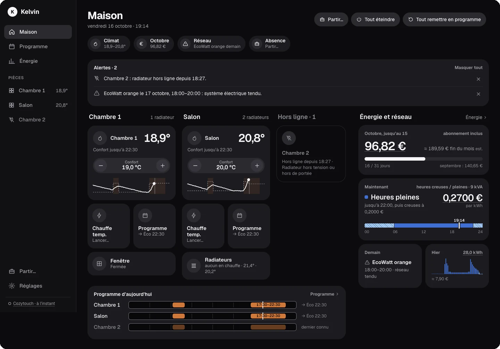
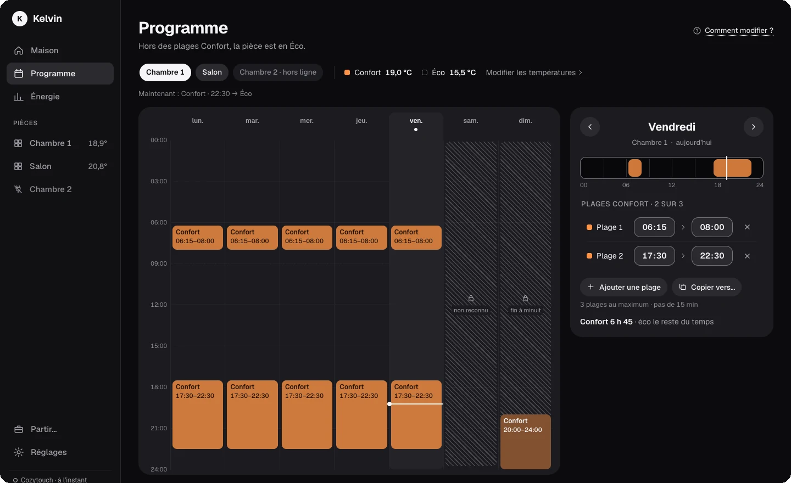
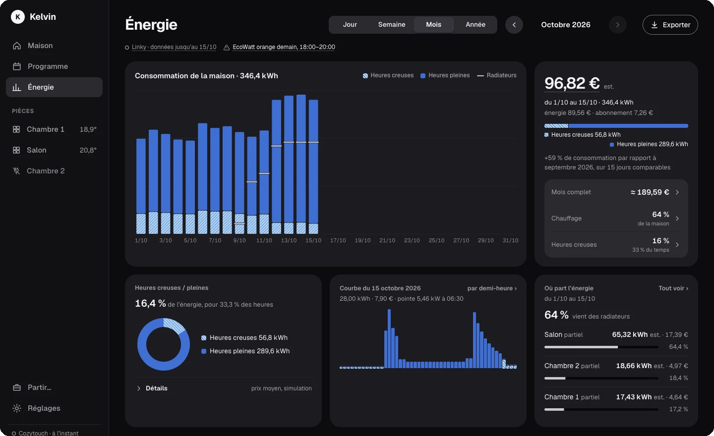
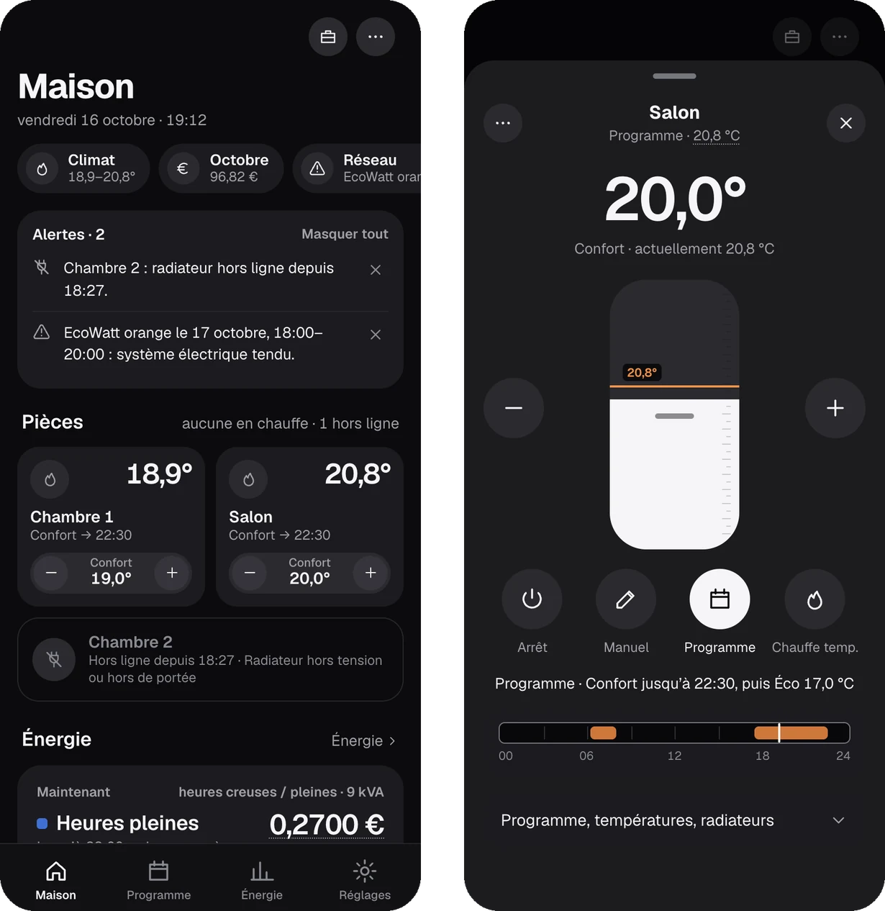

<h1 align="center">Kelvin</h1>

<p align="center">
  <strong>Your electric radiators and your electricity bill, in one calm app you host yourself.</strong><br>
  Control Sauter, Atlantic and Thermor radiators on Cozytouch, and see what your Linky meter says it costs.
</p>

<p align="center">
  <a href="https://github.com/lborruto/kelvin/actions/workflows/ci.yml"></a>
  <a href="LICENSE"></a>
</p>

<p align="center">
  
</p>

| Weekly schedule | Energy and cost |
|---|---|
|  |  |

<p align="center">
  <br>
  <sub>On a phone it installs like an app. All screenshots come from the built-in simulator (invented home, demo data).</sub>
</p>

## What it does

- **Every room at a glance.** Temperature, what the radiator is doing and until when, and −/+ to
  change it. A room with two radiators acts as one.
- **Weekly schedule.** See the week, drag the comfort periods, copy a day to others. Nothing is
  sent until you press « Envoyer ».
- **Temporary heat.** Warm one room for a couple of hours (« Chauffer à 22 °C pendant 2 h »);
  it goes back to what it was doing afterwards.
- **Away mode.** Turn the whole house down until you come back, from wherever you are.
- **Honest status.** A change counts as done only when the radiator confirms it. Pending and
  failed are shown as such.
- **Energy and euros.** Your home's consumption from Linky by day, week, month or year, priced
  with your own tariff: Base, off-peak/peak (HC/HP) or Tempo. See how much goes to the radiators,
  room by room, and export it as CSV.
- **Alerts that matter.** A red Tempo day tomorrow, an EcoWatt warning, a radiator that went
  offline, new regulated prices, a Linky consent about to expire.
- **French or English**, switched in Settings without a reload.
- **Works on your phone like an app** (installable, one dark theme, big touch targets).
- **Ask your AI assistant.** Claude and other MCP clients can read your data and suggest ways to
  pay less. Read-only: they can never change a setting.

## Get started

**You need:** Docker with Compose v2 (amd64 or arm64), the email and password of your Cozytouch
app, and, for energy, an optional free [MyElectricalData](https://www.myelectricaldata.fr) account.

```bash
git clone https://github.com/lborruto/kelvin.git && cd kelvin
cp .env.example .env          # set KELVIN_ALLOWED_HOSTS (see below); the rest can stay empty
docker compose up -d --build
```

1. Open `http://<your-server>:8070`.
2. **Log in with your Cozytouch account** (the one the Cozytouch app uses). The first login makes
   it this Kelvin's home; everyone in the household uses the same account. Not on Sauter? Choose
   **Changer** under the server name to pick Atlantic or Thermor before that first login.
3. **Add Linky (optional):** in **Réglages › Linky**, enter your meter number (PDL, 14 digits on
   your contract) and your MyElectricalData token. Then set your prices in **Réglages › Tarif**.
   The first data arrives at the next sync (08:00 or 14:00).

**Host allowlist (recommended):** put the names and addresses you type to reach Kelvin in
`KELVIN_ALLOWED_HOSTS` (for example `kelvin.lan,192.168.1.10`) before the first login. Kelvin then
refuses any other host name, which blocks DNS rebinding attacks from web pages you visit.

**Just looking?** Try the simulator, no account needed:

```bash
docker build -t kelvin .
docker run --rm -p 8070:8080 -e KELVIN_FAKE=1 kelvin
```

Open http://localhost:8070 and log in with `demo@kelvin.local` / `kelvin`.

## Use it from Claude (MCP)

Kelvin can answer questions like « Why was October more expensive than September? » or « Plan
tomorrow's red Tempo day » through your AI assistant. In Kelvin, open **Réglages › Compte › Accès
MCP**, create a token, and copy the ready-made settings it shows (once). For Claude Code:

```bash
claude mcp add --transport http kelvin https://kelvin.example.lan/mcp \
  --header "Authorization: Bearer kmcp_…"
```

Claude Desktop setup, the available prompts and tools, and the security details:
[backend/README.md › MCP](backend/README.md#mcp).

## Good to know

- **Tested on real Sauter radiators** (IPALA, HEKLA). Other Sauter, Atlantic and Thermor radiators
  on Cozytouch are expected to work; other Overkiz servers are experimental. Devices Kelvin cannot
  drive (water heaters, heat pumps…) are shown read-only, never hidden.
  [Full compatibility table](backend/README.md#device-compatibility).
- **Linky data is a day behind.** Enedis publishes yesterday's figures; Kelvin syncs at 08:00 and
  14:00 and uses at most 10 of MyElectricalData's 50 daily calls. The daily history arrives at
  the first sync; the half-hour detail fills in over the following days.
- **Your data stays at home.** Everything is stored in Kelvin's own data volume. It only talks to
  Cozytouch and MyElectricalData (for Tempo and EcoWatt it asks for dates only, nothing about you).
- **Keep it on your home network or a VPN** (Tailscale, WireGuard…). Never open it to the
  internet. More in [SECURITY.md](SECURITY.md#security-model).
- **One server per install.** The server (Sauter, Atlantic, Thermor…) is fixed at the first login.
  To change it, start Kelvin on a new, empty data folder and log in again.
- **Unofficial.** Kelvin uses the same cloud as the Cozytouch app; if that cloud changes, Kelvin
  may need an update.

## Update and back up

Update to the latest version:

```bash
git pull && docker compose up -d --build
```

The data volume holds your Cozytouch password and Linky token: treat a backup like a password
store. This writes it to your home directory, outside the checkout (so `git add` can never pick
it up), readable only by you:

```bash
backup="kelvin-backup-$(date +%F).tgz"
docker compose stop
docker run --rm -v kelvin_data:/data:ro -v "$HOME":/backup busybox:1.37 \
  sh -c "umask 077 && tar czf /backup/$backup -C /data . && chown $(id -u):$(id -g) /backup/$backup"
docker compose start
```

<details>
<summary>Restore a backup, and a note for rootless Docker</summary>

With rootless Docker, drop the `&& chown …` part above: the container's root already maps to your
user, and the chown would hand the file to a sub-uid you cannot read.

To restore, set `backup` to the archive's name in your home directory, then stop Kelvin,
replace the volume's content and give it back to Kelvin's user (uid 10001). On a new host, run
`docker compose create` first so the volume exists.

```bash
backup="kelvin-backup-2026-10-14.tgz"
docker compose stop
docker run --rm -v kelvin_data:/data -v "$HOME":/backup:ro busybox:1.37 \
  sh -c "rm -rf /data/* /data/.[!.]* && tar xzf /backup/$backup -C /data && chown -R 10001:10001 /data && chmod 700 /data"
docker compose start
```

</details>

## Help and docs

| I want to… | Read |
|---|---|
| Change a setting (environment variables, health check, reverse proxy) | [backend/README.md › Docker configuration](backend/README.md#docker-configuration) |
| Know how Kelvin protects my account | [SECURITY.md](SECURITY.md) |
| Use the API or the MCP server | [backend/README.md](backend/README.md) |
| Hack on Kelvin, run the tests, see how it works | [CONTRIBUTING.md](CONTRIBUTING.md) |
| Work on the web app, see every screen | [web/README.md](web/README.md) |
| See the design system | [DESIGN.md](DESIGN.md) and [PRODUCT.md](PRODUCT.md) |
| Read what was verified on real devices and on Linky | [docs/](docs/) |

Found a bug, or tried Kelvin on a radiator marked « expected » or « experimental »? Please
[open an issue](https://github.com/lborruto/kelvin/issues) with the device's model, never your
ids or serial numbers.

## Licence

MIT, see [LICENSE](LICENSE). Bundled fonts (Geist, JetBrains Mono) are under the SIL Open Font
License 1.1; see [THIRD_PARTY_NOTICES.md](THIRD_PARTY_NOTICES.md).

## Not affiliated

Kelvin is an independent, unofficial project. It is not made, endorsed or supported by
Atlantic, Sauter, Thermor, Cozytouch, Overkiz, Enedis or MyElectricalData. Atlantic, Sauter,
Thermor, Cozytouch, Overkiz, Enedis, Linky and MyElectricalData are trademarks of their
respective owners; they are named here only to say what Kelvin works with.
